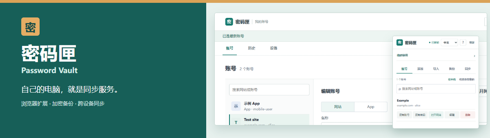

# 密码匣 Password Vault

**现有电脑就能运行同步服务的开源密码管理工具。** 浏览器扩展可以独立离线使用；需要跨设备时，再用自己的 Windows（WSL）、macOS 或 Linux 设备保存和同步加密保险库。无需购买服务器，也不依赖第三方在线密码网站。

Password Vault is an open-source password manager with a standalone browser extension, encrypted backups, and optional self-hosted sync on a computer you already own.

[](https://github.com/kangshifuSteven/password-vault/releases/tag/v0.1.0) [](#安装与启动) [](#安装与启动) [](LICENSE)

## 为什么选择密码匣

| 你需要的 | 密码匣提供的 |
| --- | --- |
| 不想购买服务器或依赖在线账户 | 扩展可离线独立使用；需要同步时，现有电脑即可运行轻量 Node.js 服务，无需 Docker 和数据库。 |
| 想让密码随时可以迁走 | 加密密码文件可迁移；另有恢复文件和独立恢复私钥。数据与备份由自己保管。 |
| 在不同设备间继续使用 | 扩展保存、修改或删除账号后自动同步到自己的服务；网页端可查看和管理历史版本。 |
| 偶尔使用别人的电脑 | 临时模式从密码文件或自建服务只读取回账号，关闭浏览器后清除会话，不建立长期保险库。 |
| 少切换工具 | 浏览器扩展可保存、生成和填充密码，尝试捕获登录与改密；也能从密码匣直接打开对应网站。 |

### 实际界面

| 浏览器扩展 | 网页保险库 |
| :---: | :---: |
|  |  |

[手机账号页](docs/screenshots/mobile-vault.png) · [手机解锁页](docs/screenshots/mobile-login.png)

## 安装与启动

从 [v0.1.0 发布页](https://github.com/kangshifuSteven/password-vault/releases/tag/v0.1.0) 下载对应压缩包，校验文件也在发布页。只用扩展时，无需安装服务。

### 浏览器扩展

| 浏览器 | 安装方法 |
| --- | --- |
| Chrome / Edge，Windows / macOS / Linux | 下载 `password-vault-v0.1.0-chrome-edge.zip`，解压到固定目录。在 `chrome://extensions` 或 `edge://extensions` 开启开发者模式，选择“加载已解压的扩展”，指向包含 `manifest.json` 的目录。 |
| Firefox 142+ 桌面版 | 下载 `password-vault-v0.1.0-firefox.zip` 并解压。在 `about:debugging#/runtime/this-firefox` 选择“临时载入附加组件”，选中 `manifest.json`。重启后需要重新载入，目前没有长期安装的签名包。 |

首次打开扩展，设置至少 **12 位主密码**，并在“备份”页分别保存加密恢复文件和恢复私钥。更新扩展时替换**原安装目录中的文件**，再在扩展管理页点“重新加载”；卸载前先备份。

### 自己的同步服务（可选）

服务需要 [Node.js 22+](https://nodejs.org/en/download)，运行在你已有的电脑上：

| 系统 | 准备工作 |
| --- | --- |
| Windows | 在管理员 PowerShell 执行 `wsl --install -d Ubuntu`，重启后进入 Ubuntu，并在 **Ubuntu 内**安装 Node.js 22+。已有 WSL 可跳过安装。 |
| macOS | 在 Mac 上安装 Node.js 22+，打开“终端”；无需 WSL。 |
| Linux | 安装 Node.js 22+，打开终端。 |

在 Ubuntu、macOS 或 Linux 终端运行以下命令。发布文件名中的 `server-wsl` 同样适用于 macOS 和 Linux：

```sh
VERSION=0.1.0
mkdir -p "$HOME/password-vault"
curl -fL "https://github.com/kangshifuSteven/password-vault/releases/download/v${VERSION}/password-vault-v${VERSION}-server-wsl.tar.gz" -o "$HOME/password-vault-server.tar.gz"
tar -xzf "$HOME/password-vault-server.tar.gz" -C "$HOME/password-vault"
cd "$HOME/password-vault"
node server/server.mjs
```

同机访问 `http://127.0.0.1:39871/`。扩展解锁后默认连接本机服务；服务停止时，扩展中的本地账号仍可使用。需要从其他设备连接，可将同一服务部署在自己可访问的设备上并配置 HTTPS；项目目前不提供托管服务。[服务端文档](server/README.md)列有 HTTPS、重启和数据目录说明。

### 其他设备与临时使用

| 场景 | 使用方式 |
| --- | --- |
| 另一台桌面电脑 | 安装扩展后从自己的同步服务加入，或使用恢复备份与恢复私钥重建。 |
| 临时电脑 | 在扩展的“临时使用”入口选择加密密码文件或自建服务。关闭浏览器后清除会话；下载的文件需自行删除。 |
| 手机、平板、macOS Safari | 打开自建服务的 HTTPS 网页，使用设备令牌和主密码手动管理网站及 App 账号；同机 Safari 可打开本机地址。 |

手机浏览器和 App 目前**不支持自动填充或自动记录**。在密码匣里编辑已有密码，只会更新保存记录；请先在对应网站或 App 完成改密。临时电脑不要保存恢复私钥。

## 与常见工具相比

| 现有选择 | 密码匣的不同之处 |
| --- | --- |
| [Google 密码管理工具](https://support.google.com/chrome/answer/95606)等浏览器内置工具 | 主密码、恢复备份和可选同步服务独立于浏览器账号；扩展也可随用随卸载。 |
| [Bitwarden](https://bitwarden.com/help/self-host-bitwarden/)等云端或自托管服务 | 适合个人轻量使用，可直接在已有电脑运行 Node.js 服务，不需要 Docker 或数据库。 |
| [KeePassXC](https://keepassxc.org/docs/KeePassXC_GettingStarted)等本地密码库 | 浏览器扩展可自动同步加密保险库；自建网页可在手机上手动管理账号。 |

Safari 扩展、Passkey、TOTP 和泄露库查询尚未提供。网页端通过 Chromium、Firefox、WebKit 内核及 280–1200px 布局测试；macOS 服务通过 CI 检查，Mac 浏览器、夸克和鸿蒙设备尚未做实机验证。

## 文档

[更新日志](CHANGELOG.md) · [安全说明](SECURITY.md) · [同步服务与 HTTPS](server/README.md) · [作者与发布来源](NOTICE.md) · [MPL-2.0 许可证](LICENSE)

开发检查：`node release-check.mjs` · `node tests/sync.test.mjs` · `node tests/firefox-compat.test.mjs`

请勿提交真实保险库、恢复文件、访问令牌或浏览器导出的明文 CSV。第三方图标许可见 [LUCIDE-LICENSE](LUCIDE-LICENSE)。
