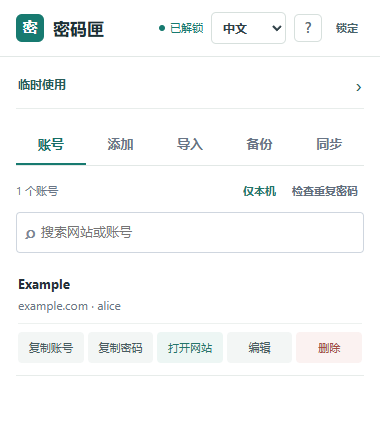
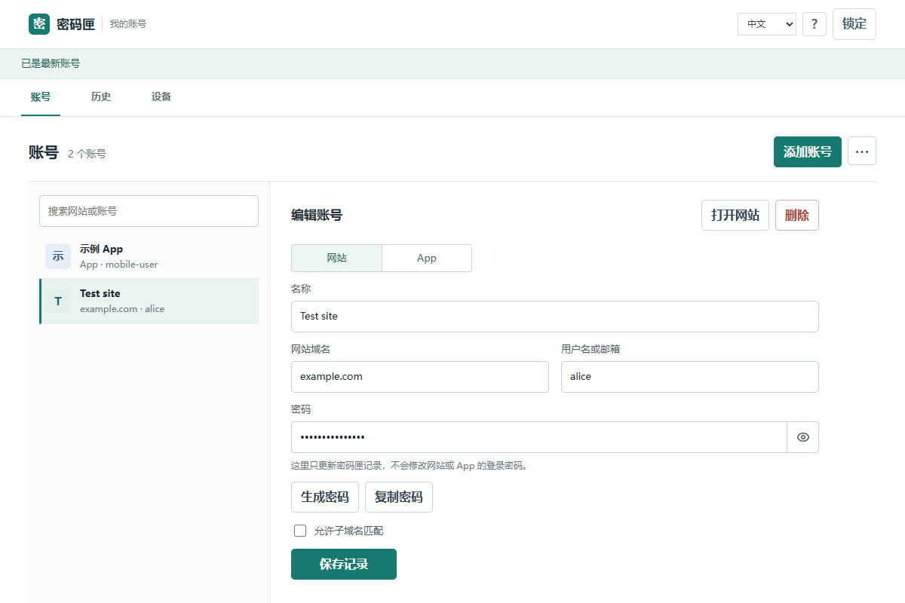
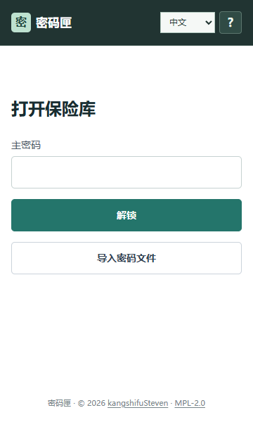
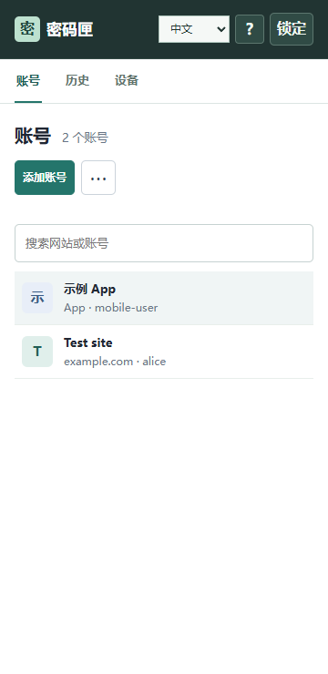

# 密码匣 Password Vault｜无需购买服务器的开源密码管理工具

密码匣是一款本机优先的开源密码管理工具：在 Chrome、Edge 等浏览器中安装扩展即可离线管理密码；需要多设备同步时，在自己的 Windows 电脑上用 WSL，或直接在 macOS、Linux 上启动轻量服务端。**不用购买云服务器，不用注册第三方密码服务，也不需要 Docker 或数据库。**

Password Vault is an open-source, local-first password manager with a browser extension, encrypted backups, and optional self-hosted sync on WSL, macOS, or Linux.

[](https://github.com/kangshifuSteven/password-vault/releases)
[](LICENSE)

当前版本：**0.1.0**

## 为什么选择密码匣

- **自己的电脑就能当服务端。**扩展在本机保存加密保险库；可选 WSL/macOS/Linux 服务端保存密文并同步设备。不开服务端也能离线使用。
- **插件化，按需安装。**不依赖外部在线密码网站运行；日常在扩展中填充和管理，换设备可通过加密备份恢复。卸载扩展前先分别保存恢复文件和恢复私钥，卸载可能删除浏览器内的保险库。
- **数据可以带走。**浏览器密码 CSV 可导入；加密密码文件、独立恢复备份和服务端数据由自己保管，不必依赖某一家浏览器的同步账号。

## 与常见密码管理方式相比

| 常见选择 | 密码匣适合的场景 |
| --- | --- |
| [Google 密码管理工具](https://support.google.com/chrome/answer/95606)等浏览器内置工具 | 浏览器也支持导出；密码匣让主密码、加密备份和可选同步服务独立于浏览器账号。 |
| [Bitwarden](https://bitwarden.com/help/self-host-bitwarden/)等云端或自托管服务 | 同样可以自托管；密码匣面向个人轻量使用，直接在现有电脑的 WSL/macOS/Linux 上运行，无需 Docker、数据库或购买服务器。 |
| [KeePassXC](https://keepassxc.org/docs/KeePassXC_GettingStarted)等本地密码库 | 同样能离线使用并集成浏览器；密码匣内置可选的密文同步服务和手机可访问的网页保险库。 |

## 目前能做什么

- 为网站和 App 保存独立账号，搜索、编辑、复制和生成密码。
- Chrome、Edge 桌面扩展支持匹配填充，并尝试记录登录、注册和改密结果。
- 导入浏览器 CSV；导出加密密码文件，以及公钥加密的独立恢复备份。
- 可选 WSL/macOS/Linux 自托管同步；网页端适合手机浏览器、平板和其他设备。远程访问需要自己配置 HTTPS 入口。
- 本机优先，服务器只保存加密保险库；多设备修改自动合并，冲突时由用户选择。

## 预览






## 下载

从 [Releases](https://github.com/kangshifuSteven/password-vault/releases) 选择对应版本：

| 文件 | 用途 |
| --- | --- |
| `password-vault-vX.Y.Z-chrome-edge.zip` | Chrome / Edge 开发者模式加载 |
| `password-vault-vX.Y.Z-firefox.zip` | Firefox 临时加载或签名安装 |
| `password-vault-vX.Y.Z-server-wsl.tar.gz` | Node.js 自托管服务，适用于 WSL、macOS、Linux |
| `password-vault-vX.Y.Z-source.zip` | 完整源码 |
| `password-vault-vX.Y.Z-checksums.txt` | SHA-256 校验 |

手机浏览器、平板和鸿蒙浏览器使用服务端 HTTPS 页面，不安装桌面扩展。

## 快速开始

1. 下载 `chrome-edge.zip`，解压到固定目录。
2. 打开 `chrome://extensions` 或 `edge://extensions`，开启“开发者模式”，选择“加载已解压的扩展”。
3. 创建至少 16 位主密码，并在“备份”页分别保存恢复私钥和加密恢复文件。

首次打开会显示操作引导。升级时使用同一扩展目录点击“重新加载”，不要移除原扩展或拖入另一份目录。

## 自托管服务

在 WSL、macOS 或 Linux 中按 [服务端说明](server/README.md) 启动服务。Mac 上安装 Node.js 22+ 后解压服务端包，在解压目录运行 `node server/server.mjs`，无需 WSL。扩展解锁后会自动连接本机服务；在同一浏览器打开服务端页面时会共享解锁状态。远程设备使用 HTTPS 地址和设备令牌加入。

## 支持范围

| 平台 | 方式 |
| --- | --- |
| Chrome / Edge（Windows、macOS、Linux） | 安装同一个扩展包，支持网页填充和自动保存尝试 |
| Firefox 桌面版 | 临时加载扩展；长期安装需要签名 |
| Safari（macOS） | 打开本机服务端网页手动管理；暂无 Safari 扩展或自动填充 |
| 手机浏览器、平板、鸿蒙浏览器 | 打开服务端 HTTPS 页面，手动查看、添加和复制 |
| 手机 App | 在网页保险库保存为 App 账号，使用时复制 |

手机端目前不读取系统密码，也不提供系统级自动填充；Safari 扩展、Passkey、TOTP 和泄露库查询暂未提供。
网页端已在 Chromium、Firefox、WebKit 内核和 280-1200px 宽度下测试；macOS、鸿蒙设备尚未做浏览器实机验证。

## 文档

- [更新日志](CHANGELOG.md)
- [安全说明](SECURITY.md)
- [服务端安装与 HTTPS](server/README.md)
- [MPL-2.0 许可证](LICENSE)
- [作者与发布来源](NOTICE.md)

## 开发

需要 Node.js 22 或更新版本：

```sh
node release-check.mjs
node tests/sync.test.mjs
node tests/firefox-compat.test.mjs
```

请勿提交真实保险库、恢复文件、访问令牌或浏览器导出的明文 CSV。

## 许可证

项目采用 [MPL-2.0](LICENSE)。第三方图标许可见 [LUCIDE-LICENSE](LUCIDE-LICENSE)。
